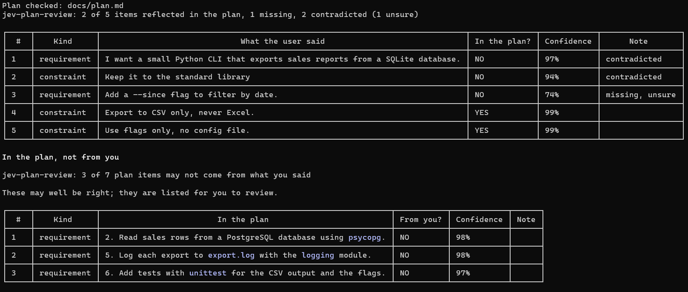

# jev-plan-review

A Claude Code plugin that helps make sure your plan keeps every requirement,
constraint, assumption and decision you stated. TypeSafe's Jev model checks
each one against the plan and flags anything missing or contradicted, with a
confidence score for each item, in under a second.



## The problem it solves

As Claude drafts a plan, you make many small calls: "use Postgres", "never
touch the generated folder", "CSV, not Excel". Checking that the finished
plan kept them all is harder than it looks:

- **Reading it yourself** is slow, and one missed line is easy to overlook.
- **Asking another agent** costs time and tokens on every plan.
- **Claude fills gaps for you.** Its assumptions and judgment calls end up in
  the plan before you've seen them, and they may not match what you want.

jev-plan-review checks every call you made against the plan for a fraction
of a cent. The review command also lists the
assumptions and decisions in the plan that you did not ask for or agree to.

It runs in two ways:

- **A hook on plan mode.** When Claude is about to show you a plan, the hook
  checks it first and sends it back to Claude to fix anything Jev is sure is
  missing or contradicted. Claude gets the table; the approval screen does
  not show it.
- **A command.** `/jev-plan-review:review` checks a plan file, the latest
  plan-mode plan, or a plan Claude made in the conversation. It shows you the
  table, and also lists what the plan decided that you never said. It never
  changes the plan.

## How it works

Each review collects what you said, splits it into statements, sorts them,
and checks each one against the plan.

1. **Collect.** Your prompts, your `AskUserQuestion` answers, feedback on a
   plan you rejected, text you pasted, and prose files you mentioned with `@`
   as something the plan must follow. Never `CLAUDE.md` or files Claude chose
   to read. Only what came after the last `/clear` and the last approved plan
   counts.
2. **Split.** One statement per bullet, numbered item or sentence. Claude's
   message just before your reply goes along as context, so a short answer
   still makes sense.
3. **Classify.** Jev sorts each statement as a requirement, constraint,
   decision, assumption or preference. Questions, thanks, choices you later
   replaced and remarks about tools are set aside. A statement Jev can't
   place is listed as `not checked`.
4. **Verify.** Jev answers two questions for each statement: does the plan
   reflect it, and does the plan conflict with it. An answer below your
   `min_confidence` is marked `unsure`.
5. **Revise (hook).** Items Jev is sure are missing or contradicted go back
   to Claude to fix, up to `max_revisions` times. Unsure items never do.
6. **Report.** The hook gives Claude the table; to see it, ask Claude what
   the review found. The command shows it to you directly. The full report
   is saved to `reports/` in the plugin's data folder.

If the key is missing or Jev fails, the hook tells Claude the review was
skipped and lets the plan through.

## Benchmarked against Claude

| Per review | Jev | Claude Sonnet 5.5 | With Jev |
| --- | --- | --- | --- |
| Cost | $0.00026 | $0.012 | **47× cheaper** |
| Time | 0.6 s | 2.6 s | **4.6× faster** |
| Items judged correctly | 97% | 99% | about as accurate |
| Plans sent back by mistake | 0 | 0 | |
| Plan items you never asked for, found | 3 of 3 | 3 of 3 | |

Measured on 10 hand-written planning sessions with known answers, two runs
each, with Sonnet given the same conversation, plan and questions. The
scenarios and code are on the
[`benchmark`](https://github.com/chinmayakelkar/jev-plan-review/tree/benchmark)
branch.

## Quick start

You need Claude Code 2.1.271 or newer, Node.js 18 or newer, and an API key
from TypeSafe or OpenRouter.

Put the key in the `env` section of `~/.claude/settings.json`, where both the
hook and the commands can read it. Use the name that matches your provider:

```json
{ "env": { "TYPESAFE_API_KEY": "<your key>" } }
```

```json
{ "env": { "OPENROUTER_API_KEY": "<your key>" } }
```

A key set in your shell works too. Never paste the key into a conversation;
transcripts are saved to disk.

Then add this repository as a marketplace and install the plugin:

```sh
claude plugin marketplace add chinmayakelkar/jev-plan-review
claude plugin install jev-plan-review@jev-plan-review
```

Restart Claude Code or run `/reload-plugins`. The defaults below apply until
you change them in `/config`. If you use OpenRouter, choose it there.

To try it from a checkout without installing:

```sh
claude --plugin-dir /path/to/jev-plan-review
```

## Usage

Plan mode needs nothing: every plan is reviewed before you see it. To check
a plan file yourself:

```
/jev-plan-review:review docs/plan.md
/jev-plan-review:review docs/plan.md --since-clear
/jev-plan-review:review
```

With no path, Claude passes in the plan it made in this conversation, or the
tool uses the latest plan-mode plan. If there is no plan, it says so. By default it uses
what you said since the last approved plan; `--since-clear` goes back to the
last `/clear`, which is what you want when checking a plan you already
approved.

## Settings

Change the settings in `/config`, where each one has its own row.

| Setting | Default | Description |
| --- | --- | --- |
| `provider` | `typesafe` | `typesafe` or `openrouter`. Decides where requests go and which key is used. |
| `min_confidence` | `80` | Percent, 50–100. An answer below this is marked `unsure` and is never sent back to Claude. |
| `auto_review` | `on` | Review every plan-mode plan before it is shown, and send it back to Claude when needed. When off, only the review command runs a check. |
| `max_revisions` | `2` | How many times one plan may be sent back, from 1 to 5. |
| `max_statements` | `150` | How many statements one review may check. Any whole number from 1 up. More statements mean more Jev questions and a longer wait. |
| `show_inconclusive` | `on` | Show the rows Jev was unsure of: `unsure` answers and `not checked` statements. When off they are left out of the table and the saved report, and one line says how many were hidden. |
| `reverse_plan_check` | `on` | In the command, also list what the plan decided that you never said. When off, the command checks only that the plan reflects what you said. |

A change takes effect for the next review. If a value can't be used, the
plugin says so, names the setting, and uses its default.

## Privacy

- Each review sends your statements, Claude's message before each of your
  replies, the plan, and the name and opening text of each file you
  mentioned with `@` to TypeSafe, or to OpenRouter if you chose it. Nothing
  else from your project is sent.
- Your key is read from your settings or shell and used only in the request
  to that provider. The plugin never stores or logs it.
- Reports stay on your computer, in the plugin's data folder.

## Limitations

- The scores are a guide, not a guarantee. The table shows you where to
  look; you still decide.
- When jev-plan-review's plan-mode hook reviews a plan, its table goes to
  Claude, not to the approval screen. Ask Claude
  if you'd like to see it.
- A change of mind can be misread. Saying what you are replacing helps, such
  as "use JavaScript instead of Python".
- In very long conversations, an item missing from the plan is more often
  judged as covered.
- At most `max_statements` statements are checked per review. Your own
  words come ahead of words from files, and newer words ahead of older ones.
- A file is used only if you mention it with `@` as something to follow,
  such as "follow the rules in @spec.md". Code files are never used.
- Plans made by subagents are not reviewed, and the hook does not list what
  the plan decided that you never said; only the command does.
- If a review takes longer than the hook's 180 seconds, the plan goes
  through without it.
- The plugin reads Claude Code's session files, whose format isn't
  documented, so a Claude Code update may need a plugin update.

## Development

```sh
npm install
npm run verify           # typecheck, test, build
npm run validate:plugin  # claude plugin validate
npm run live             # real request through TypeSafe; needs TYPESAFE_API_KEY
npm run live -- openrouter   # the same through OpenRouter; needs OPENROUTER_API_KEY
```

`dist/` is committed; rebuild before committing changes to `src/`. The unit
tests use a fake Jev and never go on the network. `npm run live` is the real
network check.

## Credits and license

MIT. The Jev client and the token estimate are adapted from
[fast-jev-compaction](https://github.com/tamaratran/fast-jev-compaction),
also MIT. See `NOTICE`.
